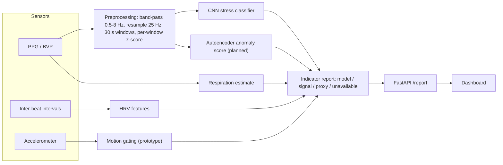

<h1 align="center">Vitalis</h1>
<div align="center">
  
### Personal-baseline health awareness for astronauts, built with techniques borrowed from LIGO

  


**Dashboard:** `TODO` &nbsp;|&nbsp; **Demo video:** `TODO` &nbsp;|&nbsp; **Slides:** `TODO`

</div>

> **Prototype decision support, not a medical device.** Vitalis is trained on lab-study data, not spaceflight data,
> and must not be used for diagnosis or treatment decisions.

## Contents
1. [Project overview](#project-overview)
2. [Key features](#key-features)
3. [System architecture](#system-architecture)
4. [ML pipeline and model details](#ml-pipeline-and-model-details)
5. [Technology stack](#technology-stack)
6. [Installation and setup](#installation-and-setup)
7. [Running the application](#running-the-application)
8. [Dataset acknowledgements](#dataset-acknowledgements)
9. [Team Stellar Nexus](#team-stellar-nexus)
10. [MIT License](#mit-license)

---

## Project overview

**The problem.** On long missions the crew will be far from real-time medical support. Wearables produce a continuous
stream of heart and motion data, but that data is noisy, and every person's "normal" is different.

**Our idea.** LIGO finds faint gravitational-wave signals in extremely noisy detector data. To do that, it separates
real signals from instrument glitches using auxiliary "witness" channels and models of what normal data looks like.
Vitalis applies the same thinking to a wearable photoplethysmography (PPG) stream: classify what the signal shows,
check it against motion, and compare each person with **their own baseline** rather than a population average, in the
spirit of NASA's Twins and Inspiration4 studies.

**What makes it honest.** Every health indicator the API returns carries a `status` (`model`, `signal`, `proxy` or
`unavailable`), so the interface only shows what is actually backed by data.

| LIGO idea | In Vitalis | Status |
|---|---|---|
| Glitch classification (Gravity Spy) | CNN classifier on 30 s PPG windows | ✅ trained |
| Witness channels (OmegaNeuron) | Accelerometer flags motion artifacts | 🟡 prototype in `src/fusion.py`, not yet wired to the model |
| Autoencoder for unmodelled signals (GWAK) | Autoencoder trained on calm windows only | 🟡 script written, results pending |
| Feature-space view (t-SNE, cosine similarity) | `src/embeddings_tsne.py` | 🟡 script written, figure pending |
| Time-frequency analysis (Q-transform) | Not used: the model reads raw 1-D windows | ⬜ not used |

These are inspirations. No code was copied from the LIGO repositories.

## Key features

| Feature | Status |
|---|---|
| Data pipeline for GalaxyPPG: loading, clock-offset correction, band-pass filtering, resampling, windowing, labelling | ✅ |
| Stress classifier (residual 1-D CNN encoder + classification head) | ✅ trained |
| Participant-level evaluation with balanced accuracy, chance baseline and per-dataset breakdown | ✅ |
| Indicator report with an honest status per indicator (`src/indicators.py`) | ✅ |
| REST API: `GET /health`, `POST /report` | ✅ |
| Model card, metrics file and smoke tests | ✅ |
| Autoencoder anomaly detector | 🟡 script written, not yet run |
| WESAD cross-dataset test and respiration validation | 🟡 scripts written, results pending |
| Motion gating from the accelerometer (witness-channel idea) | 🟡 prototype |
| Dashboard | 🟡 in progress (frontend teammate) |
| NASA Inspiration4 biomarker reference module | ⬜ planned |
| Measurement guidance, emergency guidance and reminders | ⬜ planned (cited NASA content, not model-generated) |

**Indicators returned by the API**

| Indicator | Status | Basis |
|---|---|---|
| Acute stress | `model` | CNN classifier |
| Cognitive overload | `model` | "moderate" class; unavailable if the loaded model is binary |
| Autonomic nervous system balance | `signal` | HRV (RMSSD) from inter-beat intervals |
| Respiratory rhythm | `signal` | Estimated from the PPG; validation against WESAD planned |
| Cardiovascular deconditioning | `proxy` | Heart-rate trend vs own baseline only, not a diagnosis |
| Microgravity fluid shift | `unavailable` | Needs sensors and data we do not have |
| Neurological fatigue | `unavailable` | Needs cognitive or sleep labels we do not have |
| Mitochondrial and oxidative stress | `unavailable` | Only via NASA blood biomarkers (n=4, reference module planned) |
| Cabin CO2 strain | `unavailable` | Needs a cabin sensor input |

## System architecture



**Repository layout**

```
Vitalis/
├─ README.md  LICENSE  requirements.txt  .gitignore
├─ src/
│  ├─ data/        loader.py  preprocessor.py  dataset.py  wesad_loader.py
│  ├─ models/      encoder.py  autoencoder.py
│  ├─ train.py                   training and evaluation
│  ├─ train_autoencoder.py       unsupervised anomaly detector
│  ├─ metrics.py                 balanced accuracy, confusion matrix, baselines
│  ├─ indicators.py              the indicator report
│  ├─ fusion.py                  multi-window fusion, witness-channel checks
│  ├─ api.py                     FastAPI backend
│  ├─ respiration_validation.py  PPG breathing rate vs WESAD chest belt
│  └─ embeddings_tsne.py         t-SNE of encoder embeddings
├─ tests/          test_basic.py
├─ docs/           API.md  DATA.md  REFERENCES.md
├─ frontend/       dashboard
└─ artifacts/      trained model, model_card.json, metrics.json
```

## ML pipeline and model details

### 1. Data preparation (`src/data/`)
- **Signal:** Empatica E4 BVP (PPG) from GalaxyPPG, 64 Hz. Other signals can be selected with `--signal`.
- **Clock fix:** the Polar H10 timestamps run about 9 hours ahead of the other devices and are corrected on load.
- **Filtering:** 4th-order zero-phase Butterworth band-pass, 0.5-8 Hz.
- **Resampling and windowing:** resampled to 25 Hz, cut into 30 s windows (750 samples) with 50% overlap.
- **Normalisation:** each window is z-scored on its own, so training matches live inference.
- **Labels:** each window's label comes from the study's event log.

| Class | Sessions |
|---|---|
| 0 low | adaptation, baseline, rest 1-5, meditation 1-2, standing, recovery |
| 1 moderate | stress-test preparation, screen reading, keyboard and mobile typing, walking |
| 2 high | speech stress test, singing stress test |
| dropped | jogging and running (exertion), time between sessions, participants without an event log |

### 2. Stress classifier (`src/models/encoder.py`, `src/train.py`)
- **Architecture:** a convolutional stem (kernel 15, stride 2, batch norm, max-pool), three residual blocks
  (32 to 64 to 128 channels), global average pooling to a 128-dimensional embedding, then a head
  (dropout 0.4, linear 128-64, ReLU, dropout 0.2, linear 64-classes). **302,723 parameters.**
- **Training:** AdamW (learning rate 1e-3, weight decay 1e-4), cosine learning-rate schedule, label smoothing 0.1,
  gradient clipping, class-balanced sampling, light augmentation (noise, amplitude scale, small time shift), 30 epochs.
- **Model selection:** by validation **balanced accuracy**, not plain accuracy.
- **Evaluation:** split by **participant** (never by window), so no person appears in more than one split.
  Results are reported next to the chance baseline and the "always predict the biggest class" baseline.
- **Modes:** 3 classes (low / moderate / high) or `--binary` (stress vs not stress). The API reads the number of classes
  from the checkpoint.

### 3. Autoencoder anomaly detector (`src/models/autoencoder.py`, `src/train_autoencoder.py`)
A 1-D convolutional autoencoder (32-dimensional bottleneck) trained **only on calm windows**. A window the model cannot
reconstruct well is flagged, with the threshold set at the mean plus two standard deviations of the calm validation error.
_Script written; results pending._

### 4. Results (GalaxyPPG, 3 held-out participants)
Trained on 3,391 windows from the other participants and evaluated on 570 windows from participants P10, P17 and P24.
The saved model is the epoch-9 checkpoint chosen on validation balanced accuracy.

| Metric | Result | Guessing baseline |
|---|---|---|
| Balanced accuracy | **58.7%** | 33.3% (chance, 3 classes) |
| Plain accuracy | 64.2% | 61.9% (always predict "low") |
| Recall: low / moderate / high | 69.1% / 58.0% / 48.8% | n/a |

| Experiment | Balanced accuracy | Chance |
|---|---|---|
| Train GalaxyPPG, test WESAD (cross-dataset) | pending | 50% |
| Train GalaxyPPG + WESAD, test both | pending | 50% |
| Breathing rate vs WESAD chest belt (mean error) | pending | n/a |

**Reading the result:** the model detects stress patterns above chance but modestly. The high-stress class has only
43 test windows, and three held-out people is a small sample. Full numbers: `artifacts/metrics.json` and
`artifacts/model_card.json`.

### 5. Limitations
- Lab stress tasks, not spaceflight; small held-out sets; the "moderate" class mixes several different tasks.
- Several indicators have no data behind them and are shown as unavailable on purpose.
- No NASA data was used to train the model.

## Technology stack

| Area | Tools |
|---|---|
| Language | Python |
| Machine learning | PyTorch |
| Signal processing and data | NumPy, SciPy, pandas |
| Evaluation and visualisation | scikit-learn, matplotlib |
| Backend | FastAPI, Uvicorn, Pydantic |
| Testing | Python smoke tests (`tests/test_basic.py`), httpx test client |
| Frontend | `TODO` (framework to be filled in by the frontend teammate) |
| Version control | Git and GitHub |

## Installation and setup

**Requirements:** Python 3.10 or newer (developed on Windows with Python 3.14) and about 1 GB of free disk space for
the Python packages, plus the datasets.

```bash
git clone https://github.com/team-stellar-nexus/Vitalis.git
cd Vitalis

python -m venv .venv
.venv\Scripts\activate          # Windows PowerShell
# source .venv/bin/activate     # macOS / Linux

pip install -r requirements.txt
```

**Data (not included in the repository).** Download the datasets and place them in the repo root. See
[`docs/DATA.md`](docs/DATA.md) for links and licenses.
```
Dataset/   GalaxyPPG:  Dataset/P01 ... P24/{E4,PolarH10,GalaxyWatch}/*.csv  and  Event.csv
WESAD/     optional:   WESAD/S2/S2.pkl ... S17/S17.pkl
```

## Running the application

**1. Smoke tests (no data needed)**
```bash
python tests/test_basic.py
```

**2. Train**
```bash
# GalaxyPPG, 3 classes
python src/train.py --epochs 30 --val P07,P14,P21 --test P10,P17,P24

# GalaxyPPG + WESAD, stress vs not stress, tested on both datasets
python src/train.py --wesad WESAD --binary --epochs 30 \
  --val P07,P14,P21,WESAD_S5,WESAD_S9 --test P10,P17,P24,WESAD_S13,WESAD_S17 --out artifacts_combined

# cross-dataset test: train on GalaxyPPG only, test on all of WESAD
python src/train.py --wesad WESAD --binary --epochs 30 --val P07,P14,P21 --test WESAD_ALL --out artifacts_cross
```
Outputs go to `artifacts/` (or `--out`): `best_model.pt`, `metrics.json`, `model_card.json`, `history.json`.

**3. Optional analyses**
```bash
python src/train_autoencoder.py --val P07,P14,P21 --test P10,P17,P24
python src/respiration_validation.py --wesad WESAD
python src/embeddings_tsne.py
```

**4. Start the backend**
```bash
python -m uvicorn api:app --app-dir src --port 8000
```
Open http://localhost:8000/docs for the interactive API page, or call it from Python:

```python
import httpx, numpy as np

fs = 64
t = np.arange(fs * 60) / fs
ppg = (np.sin(2 * np.pi * 1.2 * t) + 0.6 * np.sin(2 * np.pi * 0.25 * t)).tolist()
r = httpx.post("http://localhost:8000/report", json={"ppg": ppg, "fs": fs})
for item in r.json()["indicators"]:
    print(item["id"], item["status"], item["value"])
```
If no trained model is found in `artifacts/`, the stress and cognitive indicators come back as `unavailable` while the
signal-derived indicators still work. The full request and response format is in [`docs/API.md`](docs/API.md).

**5. Dashboard**
See [`frontend/README.md`](frontend/README.md) for how to run it.

## Dataset acknowledgements

| Dataset | Use in Vitalis | Credit |
|---|---|---|
| **GalaxyPPG** | Training and evaluation of the stress classifier | Park, S., Zheng, D., Lee, U. (2025). *A PPG Signal Dataset Collected in Semi-Naturalistic Settings Using Galaxy Watch.* Scientific Data 12:892. doi:10.1038/s41597-025-05152-z. Dataset: Zenodo, doi:10.5281/zenodo.14635823. Code: [Kaist-ICLab/GalaxyPPG-Supplementary-Code](https://github.com/Kaist-ICLab/GalaxyPPG-Supplementary-Code) |
| **WESAD** | Cross-dataset testing and respiration validation | Schmidt, P. et al. (2018). *Introducing WESAD, a Multimodal Dataset for Wearable Stress and Affect Detection.* ICMI 2018. [UCI repository](https://archive.ics.uci.edu/dataset/465/wesad+wearable+stress+and+affect+detection). Scientific, non-commercial use with credit to the authors |
| **NASA Open Science Data Repository** (Inspiration4: OSD-571, OSD-575) | Context and the planned biomarker reference module, not model training | Data courtesy of the NASA Open Science Data Repository, https://osdr.nasa.gov/bio/repo. Gebre et al. (2024), *Nucleic Acids Research*, doi:10.1093/nar/gkae1116 |

Not used: the MIMIC-III Waveform Database (ICU data without stress labels) and the OSD metagenomics studies.
Each dataset keeps its own license, which is summarised in [`docs/DATA.md`](docs/DATA.md). Full references are in
[`docs/REFERENCES.md`](docs/REFERENCES.md).

Parts of the code, debugging and documentation were produced with help from Claude (Anthropic).

## Team Stellar Nexus

| Name | Role | GitHub |
|---|---|---|
| Shaurya | Backend, ML pipeline and API | [@Shaurya-ey](https://github.com/Shaurya-ey) |
| `TODO` | Frontend and dashboard | `TODO` |
| `TODO` | Research and concept (LIGO-inspired design) | `TODO` |
| `TODO` | `TODO` | `TODO` |

Built for the **NASA International Space Apps Challenge 2026**. Challenge: `TODO add the challenge name`.

## MIT License

Vitalis is released under the [MIT License](LICENSE). Copyright (c) 2026 Team Stellar Nexus.
Third-party datasets and libraries keep their own licenses.

<details>
<summary>Full license text</summary>

```
MIT License

Copyright (c) 2026 Team Stellar Nexus

Permission is hereby granted, free of charge, to any person obtaining a copy
of this software and associated documentation files (the "Software"), to deal
in the Software without restriction, including without limitation the rights
to use, copy, modify, merge, publish, distribute, sublicense, and/or sell
copies of the Software, and to permit persons to whom the Software is
furnished to do so, subject to the following conditions:

The above copyright notice and this permission notice shall be included in all
copies or substantial portions of the Software.

THE SOFTWARE IS PROVIDED "AS IS", WITHOUT WARRANTY OF ANY KIND, EXPRESS OR
IMPLIED, INCLUDING BUT NOT LIMITED TO THE WARRANTIES OF MERCHANTABILITY,
FITNESS FOR A PARTICULAR PURPOSE AND NONINFRINGEMENT. IN NO EVENT SHALL THE
AUTHORS OR COPYRIGHT HOLDERS BE LIABLE FOR ANY CLAIM, DAMAGES OR OTHER
LIABILITY, WHETHER IN AN ACTION OF CONTRACT, TORT OR OTHERWISE, ARISING FROM,
OUT OF OR IN CONNECTION WITH THE SOFTWARE OR THE USE OR OTHER DEALINGS IN THE
SOFTWARE.
```

</details>
